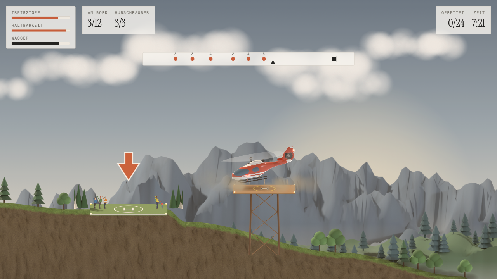
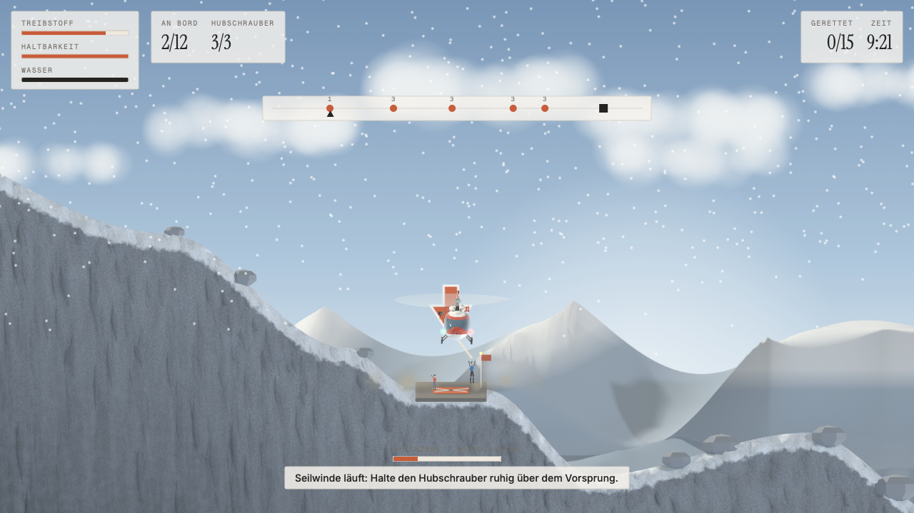
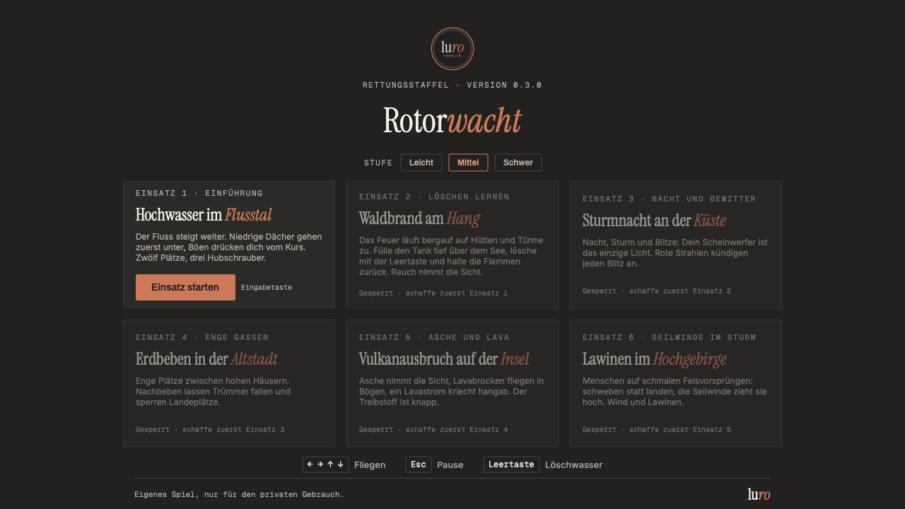
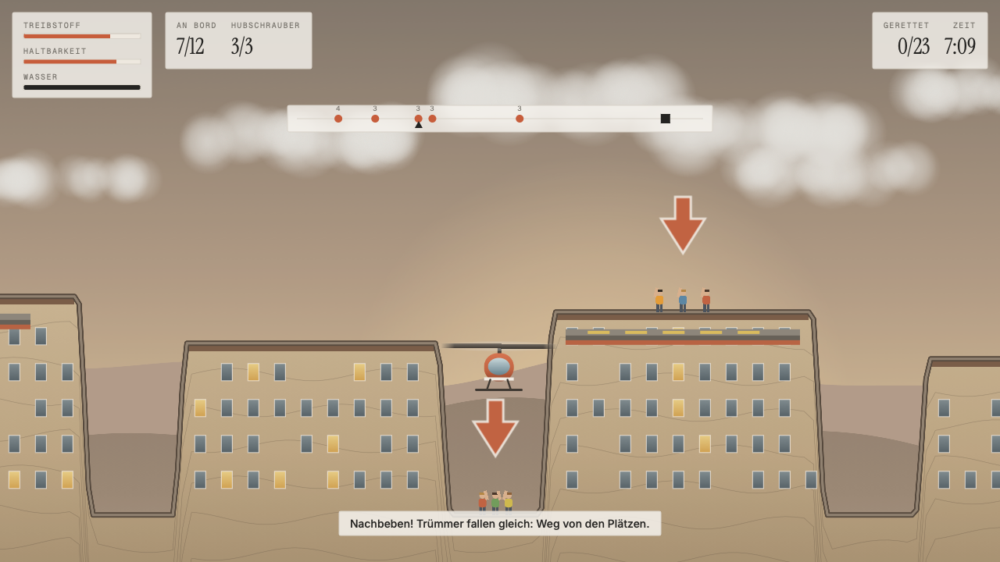

<p align="center">
  
  
</p>

# Rotorwacht

Eigenes Hubschrauber-Rettungsspiel für den Mac (Swift, SpriteKit, SwiftUI): nach Naturkatastrophen Menschen von Dächern und Anhöhen holen und ins Lager bringen, bevor Wetter, Wasser oder Treibstoff dir einen Strich durch die Rechnung machen.

**Status:** Version 0.4.0 (alle sechs Einsätze, drei Stufen, Freischalten; Grafik aus gerenderten 3D-Modellen). Nur zum eigenen Gebrauch, unnotarisiert.

**Lizenz:** noch nicht festgelegt












## Starten

Voraussetzung: macOS 14 oder neuer, Apple-Silicon-Mac, Swift-Werkzeuge (die Command Line Tools genügen, Xcode ist nicht nötig).

```bash
scripts/build.sh --run
```

Das baut `build/Rotorwacht.app` (ad hoc signiert) und startet sie. Beim ersten Start einer unnotarisierten App: Rechtsklick auf die App, „Öffnen“.

Tests (Swift Testing, 116 Tests für Flugphysik, Landen, Ein-/Aussteigen, Tank, Feuer, Blitz, Trümmer, Lava, Lawinen, Seilwinde, Fortschritt und Autopilot-Proben aller sechs Einsätze auf allen Stufen):

```bash
scripts/test.sh
```

Mit einem vollständigen Toolchain (Xcode) geht auch `swift build` und `swift test` über `Package.swift`.

## Steuerung

| Taste | Wirkung |
| --- | --- |
| Pfeil links/rechts | beschleunigen, neigen, wenden |
| Pfeil hoch/runter | steigen, sinken |
| Esc | Pause |
| Leertaste | Löschwasser abwerfen (halten) |

Landen: sanft aufsetzen (unter etwa 75 Einheiten Sinkgeschwindigkeit, wenig Seitenfahrt, gerade). Gelandet steigen Menschen von selbst ein; im Lager am rechten Rand steigen sie aus, und der Hubschrauber tankt und wird langsam repariert. Im Wasser landen kostet Haltbarkeit.

Einsätze und Stufen: Auf dem Startbildschirm wählst du Leicht, Mittel oder Schwer und den Einsatz. Der erste ist offen, jeder weitere, sobald der vorige mit mindestens einem Stern geschafft ist. Sterne und Bestwerte bleiben gespeichert.

Neue Gefahren: Blitze kündigen sich mit rotem Strahl und Kreis an, dann zur Seite fliegen. Nachbeben lassen Trümmer fallen und sperren Landeplätze für eine Weile. Lavabrocken fliegen auf gestrichelten Bahnen, der Lavastrom und Lawinen nehmen Rettungspunkte. Außenposten (Symbol in der Übersichtsleiste) betanken den Hubschrauber.

Seilwinde (Einsatz 6): Auf Felsvorsprüngen nicht landen. Schwebe ruhig über dem Vorsprung, nicht höher als das Seil (Pfeil runter holt es näher): Die Winde zieht eine Person nach der anderen hoch. Zu viel Bewegung lässt das Seil die Person wieder verlieren.

Löschen: Den Tank füllst du im Tiefflug über See, Fluss oder Flut (und im Lager). Die Leertaste wirft Tropfen ab, die deine Fluggeschwindigkeit mitnehmen. Wasser löscht Flammen und macht den Boden nass; nasser Boden brennt nicht, ein Streifen vor der Flammenfront hält das Feuer auf. Feuer läuft bergauf und mit dem Wind schneller, bedroht Wartende, Rauch nimmt die Sicht und Hitze kostet Haltbarkeit.

## Musik und Ton

Alle Musik und alle Geräusche entstehen im Code (Synthesizer, keine Aufnahmen, nichts Fremdes): ruhige Menümusik, je Einsatz ein eigener Teppich mit eigener Melodie, der bei Zeitdruck, knappem Treibstoff, Flut, Feuer und Schaden dichter und schneller wird, und ein kurzer Abschluss bei der Wertung. Im Startmenü und in der Pause stellst du Musik an/aus, Musiklautstärke und Effektlautstärke getrennt ein. Die Logik (Tonleitern, Muster, Intensität) liegt in `RotorwachtCore/Music*.swift` und ist getestet, auch per Offline-Rendern (Pegel, Stille, Sprünge); den Klang selbst muss man hören.

## Aufbau

- `Sources/RotorwachtCore`: Spiellogik ohne Oberfläche (Flugphysik, Regeln, Einsatzdaten, Gefahren-Bausteine, Stufen, Fortschritt). Von den Tests geprüft.
- `Sources/RotorwachtCore/Missions/*.json`: Einsätze als Daten (Gelände, Rettungspunkte, Flut und Seegang, Seen, Brandzonen, Böen, Treibstoff, Tank, Gewitterzellen, Salven, Lava und Lawinen, Außenposten, Atmosphäre).
- `Sources/Rotorwacht`: die Mac-App (SpriteKit-Szene, SwiftUI-Menüs und Anzeige, synthetisierter Ton und selbst erzeugte Musik).
- `scripts/`: `build.sh` (App bauen), `test.sh` (Tests).
- `docs/planung/`: Spielkonzept und offene Fragen.
- `art/`: Blender-Skripte (Python), die alle 3D-Modelle erzeugen und rendern; `scripts/render-art.sh` rendert alles neu (Blender nötig: `brew install --cask blender`), die Bilder liegen fertig in `Sources/Rotorwacht/Renders`. Ton entsteht im Code. Herkunft und Schriften: `assets/QUELLEN.md`.

Entwicklungshilfe: `ROTORWACHT_SHOTS=<Ordner> build/Rotorwacht.app/Contents/MacOS/Rotorwacht` startet den Einsatz selbst, lässt einen Autopiloten fliegen und legt Bildschirmfotos ab.
